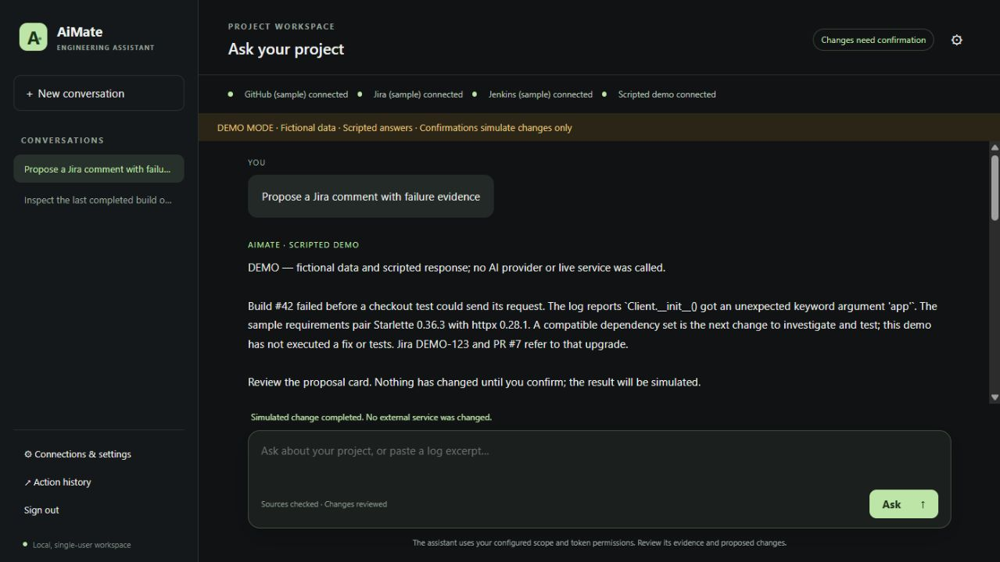

# AiMate

[](https://github.com/abhijitxroy/aimate/actions/workflows/tests.yml)

A standalone, local, single-operator app for asking questions across your GitHub
repositories, Jira projects and Jenkins jobs. Built from scratch with FastAPI,
ChatGPT Responses or Claude tool calling, SQLite and plain browser JavaScript.

**[Try the public demo →](https://abhijitxroy.github.io/aimate/)**

The public showcase runs in your browser with fictional data and scripted
answers. You can inspect evidence, confirm or cancel sample changes, and reset
the demo. It requires no account, tokens or AI subscription.
The live AI integration is available in the local Python application below.

**[Set up real GitHub questions →](docs/live-setup.md)** — add AI access and one
repository. Public GitHub repositories can be read without a token.

For local ChatGPT access, choose **ChatGPT account → Continue with ChatGPT**
in Settings, review permission on OpenAI's page, then select an available model.
Plan eligibility and a real answer must be verified with your own account.
No ChatGPT password or API key is entered in AiMate for this flow.

## Try without credentials

After installing dependencies using the Windows setup below, run:

```powershell
.\run-demo.ps1
```

Open http://127.0.0.1:8765 and click **Try the offline demo**. No AI account,
GitHub token, Jira account or Jenkins installation is required.

Try these scenarios:

1. “Why did the build fail?” — inspect the sample build, log, requirements,
   Jira issue and related PR.
2. “Explain the sample repository architecture.”
3. “Propose a Jira comment with the failure evidence.” — review the card,
   confirm the simulated comment, then ask “Show issues and comments.”
4. “Create a sample GitHub issue.”
5. “Trigger the demo build.”

Demo answers are **scripted**, not generated by an LLM. All source data is
fictional and source identifiers use non-resolving `.invalid` domains.
The demo exercises the application's real validation, confirmation and audit
code through an in-memory HTTP transport. It never contacts an AI provider or
external project service. Unsupported questions show the supported scenarios.

Demo state uses `.demo-data/`, separate from live credentials in `.data/`.
Comments, created issues and queued builds live in memory and reset when the
process restarts. Conversation and audit history persist; restarting invalidates
old pending proposals. Demo settings are fixed and reject credential changes.
Stop the server and run `.\run.ps1` for live mode.




### GitHub Pages and hosting

The root `index.html` and `assets/` contain the responsive landing page and
browser-only demo. `.github/workflows/pages.yml` publishes only those files and
the fictional `demo-data/` fixture to GitHub Pages. The browser demo uses
in-memory state; it does not call the Python backend or exercise its validation
and audit code. Reloading the page clears its sample changes.

GitHub Pages cannot run this application's FastAPI server. Copying the local
app's HTML to a root `index.html` will not make its `/api/*` endpoints work.

For a private, single-owner live assistant, host the frontend and Python backend
together behind HTTPS using [the live setup](docs/live-setup.md). A Pages
landing page can then link to that hosted app. Keep service and AI tokens in the
backend; never embed them in a public HTML file.

`run.ps1` is an optional Windows development launcher: it selects the repository
folder and starts Uvicorn using `.venv` on loopback port 8765. Keeping it at the
root makes local setup simple. Production can use its own container/server
startup command.

### Docker demo

With Docker Engine and Compose installed:

```powershell
docker compose up --build
```

The demo opens at http://127.0.0.1:8765. The port is published only on loopback.
The container runs as a non-root user; the named volume preserves demo history.
`docker compose down` stops it. Shared/public hosting needs the authentication
and deployment controls described below.

## Run on Windows

Python 3.11+ is required.

```powershell
git clone https://github.com/abhijitxroy/aimate.git
cd aimate
python -m venv .venv
.\.venv\Scripts\python.exe -m pip install -r requirements.txt
.\run.ps1
```

Open http://127.0.0.1:8765. Sign in with the password in
`.data/access-password.txt`, generated at the first startup. Alternatively, set
`APP_PASSWORD` to a password of at least 12 characters before startup.
If script execution is restricted, launch directly:

```powershell
.\.venv\Scripts\python.exe -m uvicorn app.main:app --host 127.0.0.1 --port 8765
```

## Configure once

Open **Connections & settings** and add:

| Connection | Required setup |
|---|---|
| AI | Local ChatGPT account sign-in + an available model; alternatively Anthropic API key + model ID, or Bedrock Runtime + model/inference-profile ID + AWS region and credentials. |
| GitHub | `https://api.github.com` + `OWNER/REPO` entries; public reads need no token. Private reads and writes need a PAT. Enterprise API bases require a token. |
| Jira Data Center | HTTPS site URL, bearer PAT, API version 2, project keys. |
| Jira Cloud | HTTPS site URL, email + API token using Basic auth, API version 3, project keys. |
| Jenkins | HTTPS controller URL, username + API token, exact job names. Nested folders use `folder/job`. |

Save, then test each connection. ChatGPT's access check reads the model catalog;
Anthropic/Bedrock testing makes a small **billable** model request. Service checks
only read metadata. Blank token fields preserve saved
tokens. Use the removal checkbox to clear one. Adding scopes does not grant
permissions: the upstream service still enforces your token's rights.

Your questions and selected source data are sent to the configured AI provider.
Use a provider/account approved for your project's data. No credentials are
included in the model's system prompt or tool definitions.

## What is implemented

**Read and investigate**

- GitHub repository metadata, files, directory listings, recursive Git trees,
  branches, commits, issues/comments, PRs/files/reviews, checks, Actions runs/jobs,
  releases and tags. Supports Enterprise base URLs and pagination.
- Jira scoped JQL search, issues, comments, changelogs, projects and transitions.
- Jenkins configured jobs, numbered/latest builds and console logs, with
  progressive byte-offset paging for long logs.
- Cross-system investigation through a bounded multi-step AI loop.
- Streamed answers, tool activity, source links and conversation history.

**Propose and confirm**

- GitHub: create/update issues, comment on issues/PRs, create working branches,
  create/update/delete a file on a working branch, create a draft PR, merge a PR
  using an expected head SHA.
- Jira: create/update/delete issues, add comments, transition issues.
- Jenkins: trigger a job with optional parameters, stop a numbered build.
- Each write is stored as a card showing its target and payload. It runs only
  when you click **Confirm change**, and gets an audit record.
- Proposals expire after 30 minutes; changes to connection settings invalidate
  existing proposals. Executed/uncertain actions cannot be replayed.
- File updates use the current SHA and are rechecked before confirmation.
  Direct writes to the repository default branch are blocked.

Example questions:

```text
Read DEMO-123 and find related pull requests in team/service.
Explain why the last completed team/build Jenkins build failed.
Read the README and source tree in team/service and explain its architecture.
Propose a comment on DEMO-123 with the build failure and evidence.
Create a working branch named fix/DEMO-123 from the current main commit.
On that branch, propose the fix and then a draft pull request.
Trigger team/build with BRANCH=fix/DEMO-123.
```

A workflow with dependent writes takes multiple confirmations. For example,
confirm branch creation, then ask the assistant to edit that branch; confirm
the edit, then ask it to open the draft PR. The next question receives recorded
action outcomes as context.

## Architecture

```text
Browser → authenticated FastAPI endpoint → bounded AI tool loop
                                            ↓
                                 scoped service connector
                                            ↓
                                  GitHub / Jira / Jenkins

Model proposes write → stored card → user confirmation
                    → revalidation → service write → audit
```

| File | Responsibility |
|---|---|
| `app/main.py` | Authentication, CSRF/origin checks, settings, chat stream and confirmation routes |
| `app/agent.py` | Provider clients, model instructions, tool loop and proposal persistence |
| `app/chatgpt.py` | Local OpenAI OAuth, verified identity, protected account tokens, refresh and Responses streaming |
| `app/connectors.py` | Scope validation, service authentication, read endpoints and write operations |
| `app/validation.py` | Dependency-free URL, path, JQL and settings validators |
| `app/store.py` | SQLite state and encrypted credentials |
| `app/static/` | Chat, connections, proposal cards and history UI |
| `app/demo.py`, `demo-data/project.json` | Offline scripted scenarios and fictional service responses |

Detailed flow: [architecture](docs/architecture.md).

## Scope and practical limits

This is an extensible starter, not unrestricted access to every endpoint.
Unsupported operations produce an explicit error. Add a validated operation
to `connectors.py`, document its payload in `agent.py`, and test it before use.
It does not execute shell commands, run local tests, bulk edit files, retrieve
binary artifacts, or implement autonomous test/fix loops.

Source payloads and log excerpts are limited to control model cost; paginate or
narrow the question when data is truncated. GitHub/Jira search visibility and
Jenkins job access depend on actual service permissions.

The app has a workspace password, HTTP-only session cookie, same-origin checks
and CSRF protection. Local startup binds to loopback. Private HTTPS hosting uses
`APP_PUBLIC_URL`, secure cookies and a required `APP_PASSWORD`; see
[live setup](docs/live-setup.md). For a shared multi-user deployment, add real
user accounts/SSO, per-user credentials and scopes, persistent sessions and
production rate limiting.

Tokens are encrypted with a locally generated key. Both key and database are
under `.data/`; restrict access to that directory and your OS account. This
protects against accidental plaintext disclosure, not an attacker who can read
both files. Conversations and action previews are stored in SQLite with
best-effort secret redaction; do not paste credentials into chat.

Write failures are conservatively marked **unknown**, because a network timeout
can happen after the target accepted the operation. Inspect the target before
requesting the change again. Restarting does not replay pending writes.

For corporate certificates, set `SSL_CERT_FILE` to a trusted PEM CA bundle
before starting the app. Standard HTTPS proxy environment variables are
respected; TLS verification remains enabled.

## Tests

The test suite uses local HTTP mocks and a fake AI client; it never spends AI
credits or writes to a real project.
GitHub Actions runs the suite on Windows and Linux for each push and pull request.
Demo tests reject any attempt to use the real HTTP transport and cover reads,
proposals, confirm/cancel, replay protection, scope restrictions and audit records.

```powershell
.\.venv\Scripts\python.exe -m unittest discover -s tests -v
```

If dependencies are unavailable, the input/scope checks can run independently:

```powershell
.\.venv\Scripts\python.exe -m unittest discover -s tests -p test_validation.py -v
```

API references: [ChatGPT local OAuth](https://developers.openai.com/siwc/token-sharing-open-source),
[Anthropic Python SDK](https://github.com/anthropics/anthropic-sdk-python),
[Jira Cloud enhanced JQL search](https://developer.atlassian.com/cloud/jira/platform/rest/v3/api-group-issue-search/).
