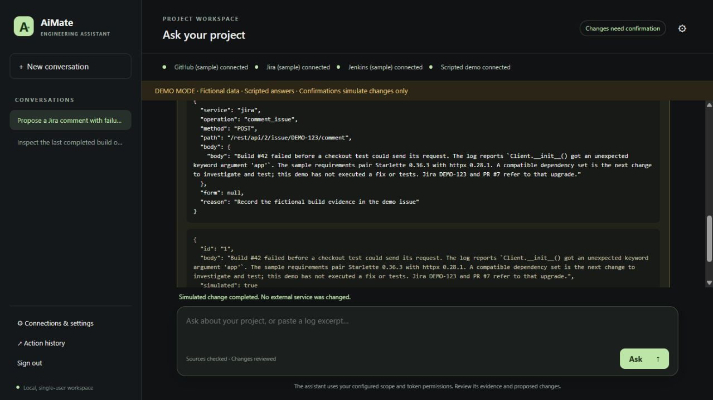

# AiMate

OpenCode with the shared Bedrock key: [setup and model routes](docs/opencode.md).

Gemini / Antigravity via Google Cloud: [secure Vertex AI setup](docs/gemini-antigravity.md).

Admin / Developer: [measured performance and before/after baselines](docs/performance.md).

[Read a requested repo before saving it](docs/repository-discovery.md).

[Local AI fallback with Ollama](docs/local-ai.md) — optional, no cloud credentials.

[App checklist and validation gaps](docs/todo-audit-2026-11-24.md) — 31 of the audited 44 items complete; 13 remain open.
[Platform roadmap](TODO.md) — desktop, VS Code and optional backends.

[](https://github.com/abhijitxroy/aimate/actions/workflows/unit.yml)
[](https://github.com/abhijitxroy/aimate/actions/workflows/integration.yml)
[](https://github.com/abhijitxroy/aimate/actions/workflows/regression.yml)
[](https://github.com/abhijitxroy/aimate/actions/workflows/flaky.yml)
[](https://github.com/abhijitxroy/aimate/actions/workflows/quality.yml)
[](https://github.com/abhijitxroy/aimate/actions/workflows/security.yml)
[](https://github.com/abhijitxroy/aimate/actions/workflows/build.yml)

A standalone, local workspace for asking questions across your GitHub
repositories, Jira projects and Jenkins jobs. Built from scratch with FastAPI,
ChatGPT Responses or Claude tool calling, SQLite and plain browser JavaScript.

**[Try the public demo →](https://abhijitxroy.github.io/aimate/)**

GitHub Pages packages the same interface as the local app, with isolated
in-memory preview records. Live AI and service access require the Python
application or a connected backend. The separate local demo mode uses fictional
data and scripted answers without credentials.
The office-laptop workspace retains authorized work connections. A separately
hosted public workspace uses a fresh data store and approved personal sources;
it never inherits the office workspace's credentials or conversations.

**[Set up real GitHub questions →](docs/live-setup.md)** — add AI access and one
repository. Public GitHub repositories can be read without a token.

For local ChatGPT access, choose **ChatGPT account → Continue with ChatGPT**
in Settings, review permission on OpenAI's page, then select an available model.
Plan eligibility and a real answer must be verified with your own account.
No ChatGPT password or API key is entered in AiMate for this flow.

## App and backend options

Python/FastAPI remains the default. Additional options are planned alongside it;
the goal is one interface and one tested feature contract across supported backends.

| Option | Status | Intended use |
|---|---|---|
| Browser + Python/FastAPI | Available locally | Current full workspace |
| GitHub Pages | Available interface/demo | Public interface; live features require a connected backend |
| Tauri desktop + bundled backend | Planned | Standalone laptop app |
| VS Code extension + backend | Planned | Same workspace with selected-code/editor context |
| Node.js + Fastify | Planned alternative | Local, desktop or server backend |
| Cloudflare Workers + TypeScript/Hono | Planned alternative | Public serverless backend |
| Supabase Edge Functions | Planned alternative | Public functions with managed data/auth services |
| Hosted Python/FastAPI | Deployment option | Same backend on a reachable server |

Choose an option based on required capabilities, infrastructure and network access.
An alternative becomes supported after it passes the shared feature tests.
Restricted runtimes can use an approved companion service for required processing.
Intel access still requires authorized network connectivity. Free hosting and AI
usage have separate limits and costs.

See [backend options and parity requirements](docs/backend-options.md) and
[the implementation to-do](TODO.md).

## Try without credentials

After installing dependencies using the Windows setup below, run:

```powershell
.\run_aimate_demo.ps1
```

Open http://127.0.0.1:8765 and click **Try the offline demo**. No AI account,
GitHub token, Jira account or Jenkins installation is required.

Try these scenarios:

1. “Why did the build fail?” — inspect the sample build, log, requirements,
   Jira issue and related PR.
2. “Explain the sample repository architecture.”
3. “Propose a Jira comment with the failure evidence.” — review the card,
   confirm the simulated comment, then ask “Show issues and comments.”
4. “Create a sample GitHub issue.”
5. “Trigger the demo build.”

Demo answers are **scripted**, not generated by an LLM. All source data is
fictional and source identifiers use non-resolving `.invalid` domains.
The demo exercises the application's real validation, confirmation and audit
code through an in-memory HTTP transport. It never contacts an AI provider or
external project service. Unsupported questions show the supported scenarios.

Demo state uses `.demo-data/`, separate from live credentials in `.data/`.
Comments, created issues and queued builds live in memory and reset when the
process restarts. Conversation and audit history persist; restarting invalidates
old pending proposals. Demo settings are fixed and reject credential changes.
Stop the server and run `.\run_aimate.ps1` for live mode.




### GitHub Pages and hosting

The root `index.html` and `assets/` contain the responsive landing page and
browser-only demo. `.github/workflows/pages.yml` publishes only those files and
the fictional `demo-data/` fixture to GitHub Pages. The browser demo uses
in-memory state; it does not call the Python backend or exercise its validation
and audit code. Reloading the page clears its sample changes.

GitHub Pages cannot run this application's FastAPI server. Copying the local
app's HTML to a root `index.html` will not make its `/api/*` endpoints work.

For a private, single-owner live assistant, host the frontend and Python backend
together behind HTTPS using [the live setup](docs/live-setup.md). A Pages
landing page can then link to that hosted app. Keep service and AI tokens in the
backend; never embed them in a public HTML file.

`run_aimate.ps1` is an optional Windows development launcher: it selects the repository
folder and starts Uvicorn using `.venv` on loopback port 8765. Keeping it at the
root makes local setup simple. Production can use its own container/server
startup command.

### Docker demo

With Docker Engine and Compose installed:

```powershell
docker compose up --build
```

The demo opens at http://127.0.0.1:8765. The port is published only on loopback.
The container runs as a non-root user; the named volume preserves demo history.
`docker compose down` stops it. Shared/public hosting needs the authentication
and deployment controls described below.

## Run on Windows

Python 3.11+ is required.

```powershell
git clone https://github.com/abhijitxroy/aimate.git
cd aimate
python -m venv .venv
.\.venv\Scripts\python.exe -m pip install -r requirements.txt
.\run_aimate.ps1
```

Open http://127.0.0.1:8765. The generated password is encrypted. Display it in
your private terminal with `.\.venv\Scripts\python.exe tools/show_workspace_password.py`. Alternatively, set
`APP_PASSWORD` to a password of at least 12 characters before startup.

Chats, tasks, My Diary and the search index use SQLCipher encryption. Existing
data requires a verified migration with the server stopped; see
[encrypted storage](docs/encrypted-storage.md). Portable restore also encrypts
old backups and protects the key for the new Windows account.

For authenticator login, open **Settings → Admin → Set up OTP**. Verify your
development password, scan the QR code with an authenticator app, and confirm a
six-digit code. Save the eight one-use recovery codes privately. OTP is enabled
only after confirmation; enrollment expires after ten minutes.

Once enabled, password login is disabled. For local development only, set
`AIMATE_DEV_LOGIN=1` before starting the server to allow a password login from
loopback. This override never works with `APP_PUBLIC_URL`. OTP seeds are
encrypted separately from project settings, and recovery codes are hashed.
Accepted authenticator codes cannot be reused, including after a restart.
This is single-workspace OTP login, not a multi-user account system or two-factor
login. The algorithm follows [RFC 6238](https://www.rfc-editor.org/rfc/rfc6238).
If script execution is restricted, launch directly:

```powershell
.\.venv\Scripts\python.exe -m uvicorn app.main:app --host 127.0.0.1 --port 8765
```

## Configure once

Open **Connections & settings** and add:

| Connection | Required setup |
|---|---|
| AI | Local ChatGPT account + an available model; Anthropic API key + model ID; or Bedrock Simple mode with only an API key (Claude Haiku 5.5, us-east-2, Runtime). Advanced exposes region, model/profile ID, bearer/IAM auth and Runtime/Mantle endpoints. Your AWS account must allow the selected model. |
| GitHub | `https://api.github.com` + `OWNER/REPO` entries; public reads need no token. Private reads and writes need a PAT. Enterprise API bases require a token. |
| Jira Data Center | HTTPS site URL, bearer PAT, API version 2, project keys. |
| Jira Cloud | HTTPS site URL, email + API token using Basic auth, API version 3, project keys. |
| Jenkins | HTTPS controller URL, username + API token, exact job names. Nested folders use `folder/job`. |

Save, then test each connection. ChatGPT's access check reads the model catalog;
[GPT via Bedrock](docs/bedrock-gpt.md) is also available with the same Bedrock
bearer key, default region `us-east-2` and GPT-6.2 Sol. Its preset dropdown
includes GPT-6.1 Sol as a manual alternative; account access requires Save & test.

Anthropic/Bedrock testing makes a small **billable** model request. Service checks
only read metadata. Blank token fields preserve saved
tokens. Use the removal checkbox to clear one. Adding scopes does not grant
permissions: the upstream service still enforces your token's rights.

Your questions and selected source data are sent to the configured AI provider.
Use a provider/account approved for your project's data. No credentials are
included in the model's system prompt or tool definitions.

You can add a source from chat: “Add OWNER/REPO to my GitHub sources.”
To replace an entry, ask “Replace OWNER/OLD with OWNER/NEW.”
AiMate uses the saved GitHub host and token to check repository, issues, PR and
Actions read access, then shows a confirmation card. Confirming rechecks access
and saves the local repository list. This works in read mode; credentials stay in
Settings. Failed checks leave the list unchanged.

Bedrock Advanced provides Standard and Analysis dropdowns with the organization's
Haiku/Sonnet/Opus 5.5, Fable 5.2, and Opus/Sonnet 5 presets, plus custom IDs.
**Refresh available models** reads AWS's current catalog for the saved region and
endpoint. It does not invoke any model or verify inference permission; use
**Save & test AI** for that. Catalog listing requires its own AWS permissions.
Runtime discovery uses ListFoundationModels/ListInferenceProfiles; Mantle uses
its separate `/v1/models` API. No automatic model fallback is enabled.

Use **Search chats** (or **Ctrl+K**) to find saved titles and messages across projects
and archived chats. Search runs locally without AI calls or token charges. Open a
result to jump to the matching turn. Expand the sidebar with its top arrow button,
or drag its right edge; the width is remembered in this browser. **Change icon**
supports emoji name search, pasted emoji, or a 1–3 character monogram.

**Tools → Appearance** switches between the default Navy theme and Beige light.
The choice is saved in this browser and also applies to the sign-in screen.

The conversation menu (`⋯`) offers Rename, Copy chat and Delete. Copy includes the
user messages, AiMate replies, citations and reviewed-action statuses as Markdown,
plus rich HTML when supported by the clipboard. Deletion requires confirmation;
completed action audit records remain. Answer styling includes scrollable tables,
code-copy controls, typed callouts, evidence-backed metric cards and bar charts.
Optional choice buttons fill the composer; they never send or execute automatically.

Connection badges retain their last verified state across restarts. While the app
is open, GitHub, Jira and Jenkins checks refresh automatically at most every five
minutes and when the tab regains focus. Settings changes invalidate the previous
result. Individual missing PRs/builds do not invalidate a service connection.
AI verification updates after real answers or explicit checks; automatic refresh
does not invoke a billable model. Hover a badge to see its last verification time.

### Auto and manual models

The ask bar offers **Auto**, **Standard** and **Analysis**. Your existing AI model
is Standard. Add an optional Analysis model under **Settings → AI model → Model
selection**, then save and check access. Both models use the same provider,
credentials and AWS region; the app does not assume access to another model.
ChatGPT offers models from the connected account's catalog.

Auto uses a separate, tool-free Standard-model request to classify a bounded
question and recent conversation excerpt. It chooses Analysis for debugging
and deeper reasoning, or Standard for routine work. Without a second model,
Auto uses Standard without classification. Manual selection skips classification.
Routing errors visibly fall back to Standard; answer errors do not silently retry
with a different model. Model access checks verify both configured models.

Each completed turn saves the selected mode, model and reported token usage,
including classification, with per-model totals. Reopening the chat retains these
details. This is usage reporting, not a provider invoice; interrupted requests
may be billed even when no completed turn is saved. See [the work plan](ROADMAP.md)
for performance, token optimization, billing, vault, privacy and role work.

## What is implemented

Implemented additions with automated coverage: [saved prompts](docs/saved-prompts.md),
[analysis templates](docs/analysis-styles.md), [task types](docs/task-types.md),
[monogram colours](docs/monogram-colours.md), [composer formatting](docs/composer-formatting.md)
and a [resumable investigation workspace](docs/investigation-workspace.md).
Usage budgets, scoped evidence paging, protected storage and role isolation are
covered in the [completion table](docs/todo-audit-2026-11-24.md).

**Read and investigate**

- GitHub repository metadata, files, directory listings, recursive Git trees,
  branches, commits, issues/comments, PRs/files/reviews, checks, Actions runs/jobs,
  releases and tags. Supports Enterprise base URLs and pagination.
- Jira scoped JQL search, issues, comments, changelogs, projects and transitions.
- Jenkins configured jobs, numbered/latest builds and console logs, with
  progressive byte-offset paging for long logs.
- Cross-system investigation through a bounded multi-step AI loop.
- Streamed answers, tool activity, source links and conversation history.

**Propose and confirm**

- GitHub: create/update issues, comment on issues/PRs, create working branches,
  create/update/delete a file on a working branch, create a draft PR, merge a PR
  using an expected head SHA.
- Jira: create/update/delete issues, add comments, transition issues.
- Jenkins: trigger a job with optional parameters, stop a numbered build.
- Each write is stored as a card showing its target and payload. It runs only
  when you click **Confirm change**, and gets an audit record.
- Proposals expire after 30 minutes; changes to connection settings invalidate
  existing proposals. Executed/uncertain actions cannot be replayed.
- File updates use the current SHA and are rechecked before confirmation.
  Direct writes to the repository default branch are blocked.

Example questions:

```text
Read DEMO-123 and find related pull requests in team/service.
Explain why the last completed team/build Jenkins build failed.
Read the README and source tree in team/service and explain its architecture.
Propose a comment on DEMO-123 with the build failure and evidence.
Create a working branch named fix/DEMO-123 from the current main commit.
On that branch, propose the fix and then a draft pull request.
Trigger team/build with BRANCH=fix/DEMO-123.
```

A workflow with dependent writes takes multiple confirmations. For example,
confirm branch creation, then ask the assistant to edit that branch; confirm
the edit, then ask it to open the draft PR. The next question receives recorded
action outcomes as context.

## Architecture

```text
Browser → authenticated FastAPI endpoint → bounded AI tool loop
                                            ↓
                                 scoped service connector
                                            ↓
                                  GitHub / Jira / Jenkins

Model proposes write → stored card → user confirmation
                    → revalidation → service write → audit
```

| File | Responsibility |
|---|---|
| `app/main.py` | Authentication, CSRF/origin checks, settings, chat stream and confirmation routes |
| `app/agent.py` | Provider clients, model instructions, tool loop and proposal persistence |
| `app/chatgpt.py` | Local OpenAI OAuth, verified identity, protected account tokens, refresh and Responses streaming |
| `app/connectors.py` | Scope validation, service authentication, read endpoints and write operations |
| `app/validation.py` | Dependency-free URL, path, JQL and settings validators |
| `app/store.py` | SQLite state and encrypted credentials |
| `app/static/` | Chat, connections, proposal cards and history UI |
| `app/demo.py`, `demo-data/project.json` | Offline scripted scenarios and fictional service responses |

Detailed flow: [architecture](docs/architecture.md).

## Scope and practical limits

This is an extensible starter, not unrestricted access to every endpoint.
Unsupported operations produce an explicit error. Add a validated operation
to `connectors.py`, document its payload in `agent.py`, and test it before use.
It does not execute shell commands, run local tests, bulk edit files, retrieve
binary artifacts, or implement autonomous test/fix loops.

Source payloads and log excerpts are limited to control model cost; paginate or
narrow the question when data is truncated. GitHub/Jira search visibility and
Jenkins job access depend on actual service permissions.

The app has a workspace password, HTTP-only session cookie, same-origin checks
and CSRF protection. Local startup binds to loopback. Private HTTPS hosting uses
`APP_PUBLIC_URL`, secure cookies and a required `APP_PASSWORD`; see
[live setup](docs/live-setup.md). For a shared multi-user deployment, add real
account registration/SSO, persistent sessions and
production rate limiting.

Tokens, vault values and image previews are encrypted. On Windows, the encryption
key is protected with current-user DPAPI; existing plaintext key files migrate
only after verification. Backups need the original Windows account/device.
Other platforms use a local key file; protect `.data/` and your OS account.
This does not protect against malware running as you. Saved conversations and
action previews use best-effort secret redaction; do not paste credentials into chat.

The Windows launcher defaults to local dev mode, opening the workspace without
a login prompt. Authenticator sign-in stays available as a secondary option. Run
`.\run_aimate.ps1 -Secure` to require the configured authenticator OTP or workspace
password. Direct Uvicorn startup requires `AIMATE_DEV_LOGIN=1` to enable bypass;
it is refused for hosted deployments, `AIMATE_ENV=production` and non-loopback clients.
Production refuses startup without an enrolled owner authenticator; password
login is disabled there. Every invited user needs their own authenticator too.

Administrators in secure mode sign in with the workspace password or a configured
authenticator OTP. Under **Connections & settings → Admin → Workspace access**, issue revocable,
30-day access codes for Developer, End-user or Reviewer. Developers can prepare
and confirm enabled changes; End-users and Reviewers can read and ask questions.
Share the user's one-time authenticator setup alongside their invitation code.
Admin can change a user's role or revoke access; existing sessions recheck the
assignment on every request. Deletes, merges and build aborts stay Admin-only.
Every invited user has a separate personal workspace: their own encrypted service
and AI credentials, ChatGPT accounts, chats, search/recall, diary, tasks, groups,
connection checks and usage ledger. Users can edit their personal connections
and records; only Admin controls roles, security and the global execution switch.
Roles and workspace isolation are enforced on the server. A Viewer or Reviewer
cannot execute external changes even with a token that permits writes.

Existing `.data/` content stays with the owner. Invited users start with empty
workspaces under `.data/users/<invitation-id>/`; owner's credentials and history
are never copied. Role changes retain the user's workspace; revoking access
blocks subsequent requests but retains their data for backup. Issuing a new
invitation creates a new workspace. Back up the entire data directory. Application
isolation does not prevent the machine administrator from accessing local files.
Self-service registration, account recovery and shared chat permissions are not
implemented.

**Private vault** stores named secrets with AI access off by default. Enabling AI
access for an entry explicitly permits sending its value to the selected provider.
The vault tool is administrator-only; answers and saved transcripts redact values.
Feedback on saved answers stays local and is visible in the administrator/developer
panel alongside the **Audit log**.

Write failures are conservatively marked **unknown**, because a network timeout
can happen after the target accepted the operation. Inspect the target before
requesting the change again. Restarting does not replay pending writes.

For corporate certificates, set `SSL_CERT_FILE` to a trusted PEM CA bundle
before starting the app. Standard HTTPS proxy environment variables are
respected; TLS verification remains enabled.

## Chats, knowledge and usage

Chats can be standalone or organized in projects and subprojects within a workspace.
Project chat lists start with five chats; **Show more / Show less**
reveals or hides older chats. Pinned chats and the current chat stay visible in project lists.
The separate **Recents** section sits below Projects and starts with three chats across projects. Each
**Show more** click reveals five more; **Show less** returns to three.
Both controls use small icons in one row. Click **Recents** to collapse or expand
the whole section; this browser remembers that choice.
Standalone chats appear there, rather than a second standalone list.
Recency uses the latest saved message, falling back to creation time. This only
changes the list view; search, history and saved data remain available.
Messages show a small faded local time beside the token badge; hover reveals the
full date/time with seconds and time zone. Reload uses the saved turn timestamp.
New answers include separately reported Anthropic cache-read/cache-write tokens
in the badge and breakdown. Responses API cached input is already included in
its input total and is not counted twice. Older turns without saved cache counts
keep their recorded totals; missing historical usage is not guessed.
Disable the optional module with `window.AiMateFeatures.messageTime=false`.
The optional `recent_chats.js` module can be disabled with
`window.AiMateFeatures.recentChats=false`; missing/disabled modules show all chats.
A project organizes chats; a workspace has separate chats, data and connection
settings. Project, Module and Group are now presented as Project; their existing
IDs and contents are preserved, including older portable backups.
Pinning keeps a chat at the top of its own project, ahead of subprojects; unpinning restores its normal order. The **Format** button shows/hides the askbar toolbar and preview without changing the draft.

Use the chat menu to rename, move, pin, copy, export Markdown, or continue in a new
chat. Continuing keeps a reference and a bounded excerpt; it does not duplicate
the entire transcript. AiMate can search relevant past user/assistant messages
and saved Knowledge key/value records. Internal tool bodies are excluded from
cross-chat recall. Recalled facts may be stale, so current status needs a fresh
service read. Knowledge records are user-managed reference data, not a password vault.
Knowledge opens in a searchable card view with copy and edit controls; use
Add / edit to manage records. To-do is a separate local task list with editing,
completion, deletion and Open / Completed / All views. [Priorities](docs/todo-priorities.md) add P0–P3 selection, sorting and filtering. Tasks persist across
restarts and are independent of chat history.

**Private** in the composer offers Session or Up to 1 day lifetimes: no transcript,
search index or image preview is saved to disk. [Lifetime details](docs/temporary-chats.md).
Signing out, login expiry or restarting clears it. Private
chats cannot prepare changes or recall other chats. Prompts and attachments still
go to your selected AI provider; token counts remain in the usage ledger.

The paperclip and clipboard paste accept images as removable preview cards
(PNG, JPEG, WebP and GIF, first frame). Images are resized before sending; up to
four per question. Documents allow up to 20 MB each (PDF, Office, ZIP and text).
PDFs allow 80 pages; scanned PDFs allow four pages per message through vision.
Extracted text allows 1,000,000 characters per file and 3,000,000 per message.
The AI reads saved text using search and 8,000-character pages, rather than loading
the whole file into each prompt. ZIPs retain separate expansion, entry and
compression-ratio limits; a larger upload does not bypass those checks.
Set `AIMATE_LARGE_UPLOADS_ENABLED=0` to restore the 4 MB upload cap without
disabling attachments. The UI reads the server's limit. Original image bytes
are not replayed on later questions.

Within an answer, identical source reads are reused and HTTP connections pooled.
Repeated tool evidence uses a compact reference. Each new question reads fresh
sources. Chat search filters matching indexed text before decoding transcripts.

**Usage & billing** tracks reported chat and Auto-routing requests by local day
and model, including cache tokens when reported. Its independent ledger survives
chat deletion. Enter your provider's USD rates per million tokens for estimates;
unpriced requests remain marked unpriced. Changing rates recalculates historical
estimates. ChatGPT subscription limits and organization invoices remain with the
provider. Connection checks and calls without reported usage are excluded.
Export daily and model breakdowns as CSV. Imported historical usage lacks provider
and cache details that were not previously saved.

## Tests

The test suite uses local HTTP mocks and a fake AI client; it never spends AI
credits or writes to a real project.
GitHub Actions separates unit, integration, browser regression and flaky checks
into [four workflows](docs/test-workflows.md). Python unit/integration suites run
on Windows and Linux; browser workflows use isolated Chromium fixtures.
Demo tests reject any attempt to use the real HTTP transport and cover reads,
proposals, confirm/cancel, replay protection, scope restrictions and audit records.

```powershell
.\.venv\Scripts\python.exe -m unittest discover -s tests -v
```

Run a specific suite with `python tools/run_test_suite.py unit`,
`integration`, `regression` or `flaky`. Flaky checks repeat critical interactions
three times and fail if any attempt fails.

If dependencies are unavailable, the input/scope checks can run independently:

```powershell
.\.venv\Scripts\python.exe -m unittest discover -s tests -p test_validation.py -v
```

API references: [ChatGPT local OAuth](https://developers.openai.com/siwc/token-sharing-open-source),
[Anthropic Python SDK](https://github.com/anthropics/anthropic-sdk-python),
[Jira Cloud enhanced JQL search](https://developer.atlassian.com/cloud/jira/platform/rest/v3/api-group-issue-search/).

## Code and conversation updates

Code, JSON and YAML use local syntax colors in every theme. See [formatting examples](docs/syntax-highlighting.md). Editing resends within the same chat. Project settings move a project with its chats and subprojects.

Attachment import shows a thin progress line: local file reading uses measured bytes; server validation is indeterminate. Cancel stops the pending request without adding a card. Set `window.AiMateFeatures.importProgress=false` to disable this optional UI.

Saved chats receive a title and topic icon from their first saved question. Later questions preserve both, including manual names/icons. Set `AIMATE_INITIAL_IDENTITY_ENABLED=0` to retain titles while disabling automatic icon assignment.

A workspace permits three concurrent replies, one per chat, to bound resources and provider rate pressure. Stop affects only the visible chat. Help → Troubleshooting explains the limit.

**Additional themes:** Appearance offers Life and Brown & Gold. Import a version 1 theme JSON (up to 4 KB) using its downloadable template. Only nine hex colour tokens are accepted; dark surfaces and readable text/status contrast are required. Imports contain no CSS, scripts, URLs or external assets. Your browser keeps the palette locally. `window.AiMateFeatures.extraThemes=false` disables these choices without affecting the three core themes. Light theme imports remain unsupported; use Beige.

**Favorite messages:** use the small star beside a saved user message or AiMate reply. Favorites keeps formatted text, opens the original chat and supports paging, Copy and Unpin. Pins are references in existing encrypted turn metadata, so deleting/editing away the original turn also removes its favorite. Portable backup/restore carries these metadata records. Private/incomplete chats cannot save favorites. Set `AIMATE_MESSAGE_FAVORITES_ENABLED=0` (server) or `window.AiMateFeatures.messageFavorites=false` (UI) to disable the module without deleting pins.

**Feedback review:** Settings → Admin → Feedback shows workspace feedback as cards. Admin/developer reviewers can record an assessment, state, evidence and a reply; confirmed issues can create one linked P1 bug To-do. Evidence is required for a confirmed issue; a reply is required for a resolution or already-available feature. Replies can be read through the feedback form. Assessment is manual, not an AI truth claim. Reviews persist separately from deleted chat turns, are included in encrypted backups, and redact saved secrets. Set `AIMATE_FEEDBACK_REVIEW_ENABLED=0` or `window.AiMateFeatures.feedbackReview=false` to disable review while retaining the original feedback capture/log.
