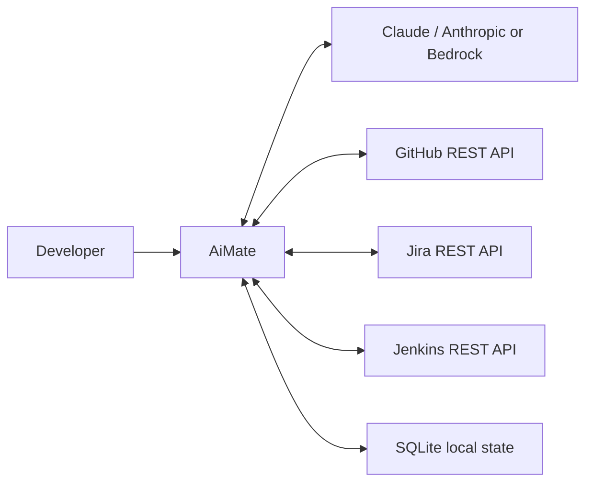
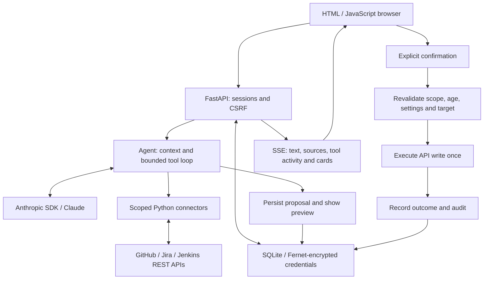

# AiMate architecture

## Level 0

## Level 1

Credentials authenticate service requests in the backend. They are excluded from
model context. Returned source data is treated as untrusted evidence.
The application executes an explicit allowlist of operations. The model does
not receive shell execution or unrestricted API access.

## Offline demo

`AIMATE_DEMO=1` selects a separate mode at startup. It uses `.demo-data/`,
ignores live provider configuration and refuses settings updates.
`run_demo_turn` chooses an explicitly supported scripted scenario.
`DemoBackend` supplies fictional responses via `httpx.MockTransport`, while
the same `Services` code still checks scope and plans requests.

Confirmation changes only the in-memory fixture state and adds an audit entry
with a simulated result. Tests fail if the real HTTP transport is invoked.
There is no LLM inference, network retrieval or live write in this mode.

## Limits

This is a single-operator application, run locally or privately behind HTTPS
with `APP_PUBLIC_URL` and `APP_PASSWORD`. In-memory sessions and rate limits
are process-local. Demo login is available only when demo mode is explicitly
enabled. A shared deployment requires real authentication, per-user credentials,
durable sessions/rate limits, HTTPS and deployment controls. SQLite data and its
encryption key reside together, so OS/filesystem access remains the trust boundary.

Live service integration and answer quality must be evaluated with real accounts.
Offline tests verify application behavior, not access to remote infrastructure.
