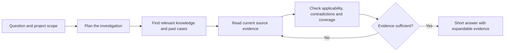

# Search quality: highest-priority workstream

Owner: AiMate. Created 26 November 2026. Parent To-do:
`backlog-c271f2bb931810eef633f7c7`. Status: **in progress**.

The goal is accurate, evidence-backed answers that meet or exceed an agreed
reference benchmark. Saving time and tokens matters after correctness. A
previous answer or similar failure is a lead, never proof of today's cause.

## Answer flow

If permission, missing data or a configured budget prevents completion, report
the unresolved question and coverage gap. Do not turn a plausible explanation
into a confirmed result. Show short progress stages and an evidence summary,
not hidden model reasoning.

## Data responsibilities

| Layer | Responsibility | Proposed reuse rules |
|---|---|---|
| Source systems | Current code, tickets, builds, operational records | Verify identity, permissions, timestamps and source versions |
| Read-only project-data connector | Approved domain queries and aggregations | Scope and row/time limits; cite dataset freshness and denominator |
| Knowledge repository, such as Nexus | Reviewed runbooks, observations and failure patterns | Commit-pinned evidence; respect record status, applicability and access |
| AiMate encrypted database | Chats, Diary, tasks, documents, cases, provenance, feedback and indexes | Separate private, candidate and shared records; retain source attribution |
| Retrieval index | Find relevant records using metadata, exact matches and full-text ranking | Index only permitted content; embeddings/reranking remain optional adapters |
| Evidence cache | Avoid fetching identical, previously authorized evidence repeatedly | Separate immutable snapshots from mutable facts; mark cached/stale data |
| Provider prompt cache | Reuse stable prompt prefixes when supported | Track reported cache usage; this is not a factual knowledge store |
| Investigation checkpoint | Resume file/log coverage without restarting the work | Pin versions, preserve missing ranges, and revalidate changed sources |

Current AiMate already has SQLCipher storage, full-text chat recall, encrypted
briefs, read-coverage checkpoints and a small immutable GitHub cache. It does
not yet have a project-data mirror or a structured reusable failure-case store.
The knowledge repository contains references; it is not the live CI database.

## Sub-To-dos and order

These are separate application To-dos, linked by their SQ number and parent ID.
They are not all complete merely because this plan exists.

| ID | Work | Completion evidence / dependency |
|---|---|---|
| SQ-01 | Audit reference/AiMate storage, caches, retrieval and knowledge architecture | Code audit; document implementation versus runtime unknowns |
| SQ-02 | Establish the matched benchmark and independently verified expected facts | Same prompts, needed context, access, versions and model metadata; full reference answers needed |
| SQ-03 | Add dedicated scoped file discovery and content search | Pinned sources, bounded results, explicit gaps, permissions and disabled-module tests |
| SQ-04 | Connect the configured knowledge repository | Validate access; index selected documents/metadata by commit; do not import credentials or every repository automatically |
| SQ-05 | Add a structured failure/observation/case store | Symptom, signature, conditions, environment/version, evidence, diagnosis, resolution, outcome, review status, dates and visibility |
| SQ-06 | Improve retrieval and ranking | Exact identifiers + metadata + full-text ranking; measure missed/irrelevant matches; optional reranker only when justified |
| SQ-07 | Add an approved read-only project-data adapter | Endpoint/schema/access still required; personal settings/chat/vault tables are not domain data |
| SQ-08 | Add a thorough investigation and evidence gate | Plan, inspect, cross-check, resolve contradictions and finish coverage before a verdict; checkpoint unfinished work |
| SQ-09 | Improve cache tiers, freshness and invalidation | Credential/workspace/source-version keys, bounded retention, expiry, changed-source handling, no stale-as-live claims |
| SQ-10 | Verify Standard/Analysis selection on real work | Available Analysis model, manual control, honest fallback and recorded model/token usage |
| SQ-11 | Make answers compact and modular | Short verdict; key findings/action table; optional causes, evidence and technical details; accessible colour and measured charts only |
| SQ-12 | Measure quality, latency, tokens and cost | Matched before/after samples; critical factual errors are release blockers, not averaged away |
| SQ-13 | Capture useful learning and reviewed promotion | User-controlled candidate records; human review before sharing or repository writes; link corrected/retired cases |
| SQ-14 | Verify isolation, migration and end-to-end behaviour | Relevant local tests and all seven workflows per code batch; real-source validation separately recorded |
| SQ-15 | Add contextual tiny answer-quality labels | Beside token usage only when useful; confidence, coverage, missing evidence and further investigation on hover/click; no invented accuracy percentages |
| SQ-16 | Read connected local evidence and Git; verify hashes and inventories | Desktop-owner scope; fixed read-only commands; complete paging and deterministic preserved-file aggregation |
| SQ-17 | Fetch and inspect Jira attachments/design images | Validate issue/host/size, use configured model vision, preserve source identity and actual coverage |
| SQ-18 | Retain and reconcile inventory snapshots | Frozen populations, canonical identities, collection scope and deterministic before/after comparisons |

SQ-03 and SQ-15 are implemented and verified at commit `12f98aa`.
SQ-04/05/06 follow. The broader workstream remains open. SQ-02 starts in
parallel as evaluation preparation, but parity remains unverified until its
real comparison inputs are available. Each code batch must remain independently
disableable and preserve existing data and core permissions.

## Reusing a common failure

1. Find candidate cases by signature, identifiers and relevant metadata.
2. Read their evidence and outcome. Exclude retired or inapplicable cases.
3. Compare the current version, environment, symptoms and live source evidence.
4. Explain whether it is a confirmed recurrence, a possible match, or a different
   cause. Cite both the past case and current evidence.
5. Offer a useful observation for saving. Never silently promote an answer into
   shared knowledge or turn a repeated symptom into a proven root cause.

## Readable final answers

Default: a brief answer followed by a small findings table and next action.
Expose **Evidence**, **Known gaps**, **Why this conclusion**, and **Technical
details** only when useful; long sections should be expandable. Use code fences,
tables, measured metrics and restrained theme colours. Charts must contain real
measured values. Do not make the reader inspect dozens of raw tool messages to
understand the result. A comprehensive report remains available on request.

SQ-15 adds compact quality details beside token usage for analysis, review,
design/architecture and technical notes. Simple replies have no scorecard;
factual search uses minimal source-confidence details. Clearly distinguish the
model's assessment from independently measured accuracy. Keep benchmark
evaluation and the broader evidence gate open until verified.

## Acceptance

Use agreed cases covering search, cross-file analysis, PR review, ticket/build
links, full logs, data aggregation, recurring failures, misleading lookalikes,
stale knowledge, denied access and follow-ups. Independently verify factual
accuracy, key-fact coverage and citation support. Measure speed/cost separately.
No critical factual regression is allowed per agreed case. Do not claim a
percentage improvement or universal parity from fixtures, a screenshot or
model selection alone.

## Verified batch — 26 November 2026

- SQ-03: native/Responses search paths and real saved-repository GETs passed.
- SQ-15: fixture persistence/restore rendering and a real private Claude review passed; the test chat was cleared.
- All seven implementation workflows passed at `12f98aa`; browser evidence: https://github.com/abhijitxroy/aimate/actions/runs/45763472025.
- Local checks: 50 unit, 312 integration (including 7 pre-existing unpublished export-package draft tests), 75 browser tests.
- Benchmark parity, Nexus indexing, domain data, incident learning and independent accuracy measurement remain open.

## Verified local-evidence and presentation batch — 26 November 2026

SQ-16 is complete at `df2b72c`: connected-folder reads, fixed Git inspection, hashes, manifests and deterministic preserved-file row/group counts. The live model returned the independently verified documentation hash; Dashboard Git and Nexus knowledge-directory reads passed. Message actions moved to bottom-right; outer assistant cards were removed and meaningful theme-aware highlights verified live.

All seven workflows passed at this commit: https://github.com/abhijitxroy/aimate/actions/runs/45769348609. Delivered CI inventory: 50 unit, 312 integration and 77 browser tests; reliability checks repeat their selected cases. The preceding Windows failure was corrected by checking actual folder identity across path aliases.

SQ-17 (Jira attachments/vision) and SQ-18 (retained historical populations/reconciliation) remain open. Local Nexus access does not yet mean repository indexing or reusable case learning is complete. The matched benchmark remains unverified.
